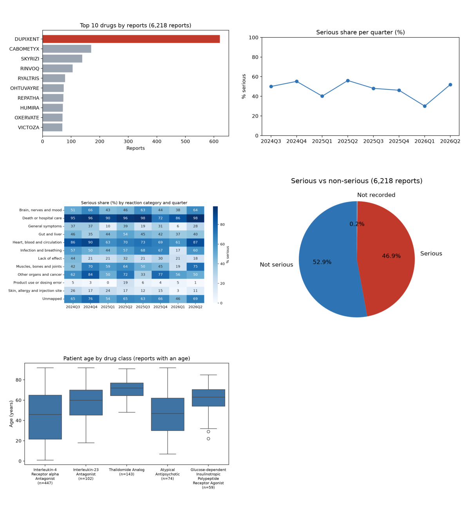

# PharmaFlow Foundation: an openFDA adverse-event pipeline

[![View the notebook on nbviewer][badge]][nbviewer]

A Python and SQL pipeline that pulls drug adverse-event reports from the
openFDA API, cleans them, stores them as Parquet with DuckDB and answers
"which ten drugs have the most reports?". Built during the Elevox AI Academy
Data Engineering pathway (Stage 0).

## How to run it

In a GitHub Codespace (Python 3.11), from the repository folder:

    pip install -r requirements.txt
    python scripts/ingest.py           # 300 raw reports from the practice API
    python scripts/clean.py            # 191 usable reports, cleaned
    python scripts/store_and_query.py  # Parquet + top 10 drugs: "Pipeline OK"

`python scripts/ingest.py --live 1000` pulls from the real openFDA API.
The SQL library runs with `python week03/session_3_3/run_library.py` and
prints "Library OK". The charts are in
[notebooks/foundation_charts.ipynb](notebooks/foundation_charts.ipynb);
to rerun it, start JupyterLab with `jupyter lab --no-browser --port=8888`
and open the link it prints.

## What is in this repository

| Folder | What it holds |
|---|---|
| [scripts/](scripts/) | the pipeline: ingest, clean, store and query |
| [queries/](queries/) | the SQL library: ten documented business questions |
| [notebooks/](notebooks/) | the five-chart analysis for Medical Affairs |
| [data/raw/](data/raw/) | the input files, never changed |
| [data/processed/](data/processed/) | results: Parquet answers and charts |
| `week01/` to `week04/` | coursework, session by session |

[badge]: https://raw.githubusercontent.com/jupyter/design/master/logos/Badges/nbviewer_badge.svg
[nbviewer]: https://nbviewer.org/github/baghelns/pharmaflow-ai/blob/main/notebooks/foundation_charts.ipynb

## Data sources (added by the Data Manager)

- data/raw/openfda_practice_sample.json: 300 real openFDA reports, served
  by the practice API (Session 1.3)
- data/raw/adverse_events_10k.csv: 6,218 usable openFDA reports,
  2024-2026 (Week 2)

 
## Findings
 
Five business questions, answered from 6,218 real openFDA adverse-event
reports (2024-07 to 2026-06). Each answer links the file it comes from.
 
### Q1. Which ten drugs have the most reports?
 
DUPIXENT leads with 621 reports (8.4% serious), then CABOMETYX 170 and
SKYRIZI 139; VICTOZA is tenth with 69
([queries/03_top10_drugs.sql](queries/03_top10_drugs.sql)). Six of the ten
have at least one bulk-submission day (Q5): the ranking partly reflects
how reports were sent in, not only how often a drug is reported.
 
### Q2. How did the serious share move by quarter?
 
Between 30.0% and 56.1% of reports are serious in every quarter
([chart](data/processed/charts/lab2_serious_share_quarter.png),
[queries/07_serious_by_quarter.sql](queries/07_serious_by_quarter.sql)).
The 2026 Q1 low of 30.0% comes from four single-drug batches, not from a
change in safety.
 
### Q3. Which reaction categories are most often serious?
 
Death or hospital care (92.0% serious) and heart, blood and circulation
(75.3%); product use or dosing errors are serious only 4.9% of the time
([queries/06_reaction_categories.sql](queries/06_reaction_categories.sql)).
The categories were built for this course, not MedDRA, and 1,935 reports
(31.1%) have no category.
 
### Q4. Which drug classes lead, and which drug leads each?
 
The Interleukin-4 Receptor alpha Antagonist class has the most reports
(630, 9.2% serious), almost all of them DUPIXENT (621); the Janus Kinase
Inhibitor class is the most often serious (79.5%), led by RINVOQ
([queries/05_drug_classes.sql](queries/05_drug_classes.sql),
[queries/09_rank_in_class.sql](queries/09_rank_in_class.sql)).
 
### Q5. How far can these numbers be trusted?
 
Patient age is missing in 48.5% of reports and country in 6.5%
([queries/02_missing_values.sql](queries/02_missing_values.sql)). On 16 of
the 104 sampled days one drug sent half or more of the day's reports: 894
bulk-submission reports, 3.9% serious
([queries/08_bulk_submissions.sql](queries/08_bulk_submissions.sql)). The
sample took about the same number of reports from every month, so counts
describe the sample, not reporting volume.
